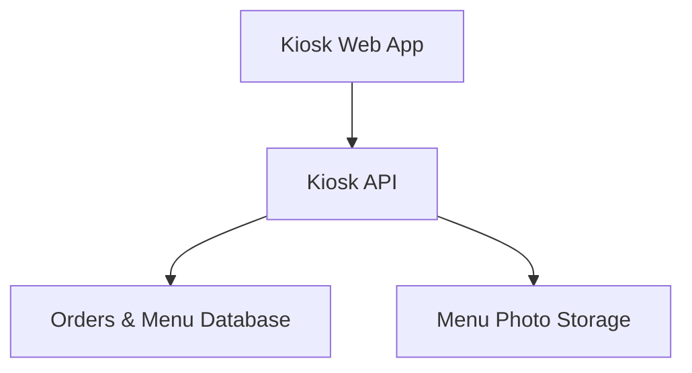
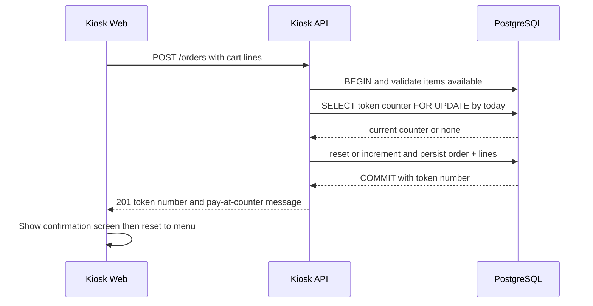
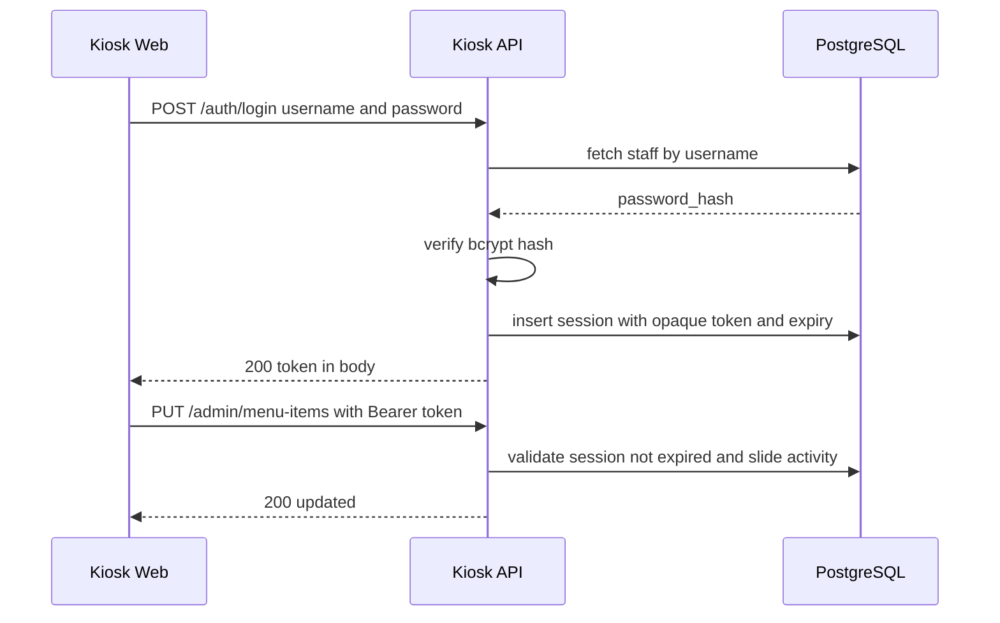
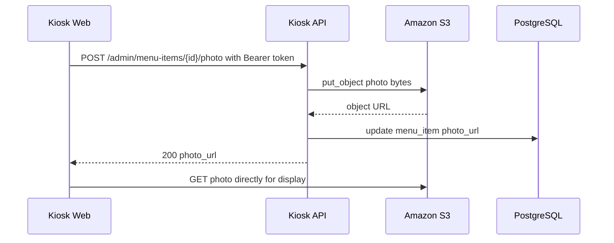
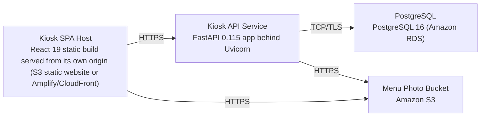

# Architecture

> Maintained by QuorQ AI SDLC. Text between `sdlc:auto` markers is regenerated; anything outside them is yours and is kept.

<!-- sdlc:auto:start narrative -->
## Overview

### ARCH-001 · approved · source: architecture:summary

Overall system architecture approved as v1: a single-location bakery self-order kiosk built as a React 19 touch web app backed by a FastAPI JSON API and PostgreSQL, deployed on AWS.

Customers browse the menu by category, build a cart with quantities and simple options, confirm (pay-at-counter, no in-kiosk payment), and receive a human-readable sequential token that resets daily, shown on a confirmation screen for the bakery's existing tracking display to pick up. Staff sign in to a password-protected admin to manage items, prices, photos (stored in S3) and sold-out flags. Every confirmed order is persisted with its token, lines and status; a read-only REST/JSON orders API plus starter documentation lets the out-of-scope tracking app integrate later. Sign-in uses server-side opaque-token sessions sent as Authorization: Bearer because the SPA and API are served from separate origins.

### ARCH-002 · approved · source: architecture:components:kiosk_web

Kiosk Web App (React 19) is the touch-friendly SPA customers use to browse, order and confirm, and also hosts the staff admin screens.

Responsive React SPA for customers: browse menu by category, maintain a cart with quantities/options, review/edit the cart, confirm the order, and show the order token confirmation screen. Also hosts the staff admin screens (menu, price, photo, sold-out management). Built as a static SPA served from its own origin, calling the API with a stored bearer token.

### ARCH-003 · approved · source: architecture:components:kiosk_api

Kiosk API (FastAPI 0.115) is the REST/JSON backend serving menu data, accepting and storing orders, issuing daily tokens, exposing a read-only orders feed, and handling staff auth and menu/photo management.

Responsibilities: serve menu; accept and store orders; generate sequential daily-reset tokens transactionally; expose a read-only orders feed; staff auth via opaque-token sessions; menu management; S3 photo upload. Chosen for automatic OpenAPI docs that let another team integrate the read-only orders feed without the original authors, and for handling transactional token issuance and S3 uploads at this modest scale.

### ARCH-004 · approved · source: architecture:components:database

Orders & Menu Database (PostgreSQL 16) is the durable relational store for menu, orders, the daily token counter, staff users and sessions, providing transactional integrity for token issuance.

Durable relational store for menu, categories, orders and lines, the daily token counter, staff users and active sessions. Chosen to give exact, transactional issuance of the sequential daily token via row locking so tokens never duplicate or skip (AC-016), and to durably store orders, menu, staff and sessions so orders survive restart and back the read API (NFR-005).

**Related:** AC-016, NFR-005

### ARCH-005 · approved · source: architecture:components:photo_store

Menu Photo Storage (Amazon S3) stores menu item photos outside the database and serves them quickly to every kiosk.

Staff-uploaded item photos are streamed to an S3 bucket by the API; the resulting object URL is stored on the menu item and the kiosk renders the photo directly from S3 rather than through the API or database.

### ARCH-006 · approved · source: architecture:critical_paths:Confirm order and issue daily token

Confirming a non-empty cart triggers transactional, availability-checked, daily-reset sequential token issuance with no payment step.

Customer confirms a non-empty cart. The API validates items are still available, opens a transaction, locks/advances the current day's token counter (resetting if the date rolled over), persists the order with lines and options, and returns the token. Payment is handled at the counter, so there is no payment step in this flow.

**Related:** AC-016

### ARCH-007 · approved · source: architecture:critical_paths:Staff sign-in and session validation

Staff authenticate with username/password; the API issues an opaque bearer session token, validates it on each admin call, slides inactivity, and revokes it on sign-out.

Staff submit username and password. The API verifies the bcrypt hash, creates a server-side session row with an opaque token and expiry, and returns the token in the response body. Subsequent admin calls send Authorization: Bearer <token>; the API checks the session is unexpired and slides the inactivity window forward. Sign-out revokes the session row so the token stops working.

### ARCH-008 · approved · source: architecture:critical_paths:Staff upload menu item photo to S3

Signed-in staff can upload a photo when adding or editing a menu item; the API stores it in S3 and saves the URL on the item.

Signed-in staff upload a photo when adding or editing an item. The API streams the file to S3 under the project's bucket, stores the resulting object URL on the menu item record, and the kiosk renders the photo directly from S3.

### ARCH-009 · approved · source: architecture:entities

Data model covers categories, menu items and their options, orders and order lines, the daily token counter, and staff users/sessions.

Entities: categories(id, name, display_order); menu_items(id, category_id, name, price, photo_url, is_sold_out, created_at, updated_at); menu_item_options(id, menu_item_id, name, display_order); orders(id, token_number, token_date, status, total, created_at); order_lines(id, order_id, menu_item_id, item_name, unit_price, quantity, line_total, selected_options); daily_token_counter(token_date, last_token); staff_users(id, username, password_hash, created_at); staff_sessions(token, staff_user_id, created_at, last_activity_at, expires_at).

### ARCH-010 · approved · source: architecture:endpoints

REST/JSON API exposes customer-facing menu and order endpoints, a read-only orders feed for the future tracking app, and staff auth/admin management endpoints.

GET /menu/categories - list categories in display order. GET /menu/categories/{category_id}/items - list items in a category with name, price, photo_url, sold-out flag and options. POST /orders - confirm an order from a non-empty cart, validate availability, issue next daily token transactionally, persist order/lines, return token with pay-at-counter message. GET /orders - read-only list of stored orders (token, lines, status, timestamp) for the future tracking app. GET /orders/{id_or_token} - read-only fetch of a single order by id or by current day's token. POST /auth/login - staff sign-in, verifies hashed password, creates server-side session, returns opaque bearer token. POST /auth/logout - revoke current session. GET /admin/menu-items - list all items including sold-out, for staff management. POST /admin/menu-items - create item (name, category, price, optional options). PUT /admin/menu-items/{id} - edit name, category, price or options. PATCH /admin/menu-items/{id}/availability - mark sold out or available. POST /admin/menu-items/{id}/photo - upload photo to S3 and store its URL on the item.

### ARCH-011 · approved · source: architecture:deployment_nodes

Deployment is four AWS-hosted nodes: a statically-built SPA, a containerized FastAPI service, managed PostgreSQL, and an S3 photo bucket.

Kiosk SPA Host: React 19 static build (Node 20 build) served from its own origin (S3 static website or Amplify/CloudFront). Kiosk API Service: FastAPI 0.115 app behind Uvicorn, Python 3.12 container on AWS (ECS/App Runner). PostgreSQL: PostgreSQL 16 on Amazon RDS, managed. Menu Photo Bucket: Amazon S3 object storage.

### ARCH-012 · approved · source: architecture:technology_decisions

Technology stack chosen: React 19 frontend, FastAPI 0.115 backend, PostgreSQL 16 database, AWS cloud -- each justified against named alternatives.

Frontend: React 19 (vs. Vue, Svelte) -- drives the touch-friendly, state-heavy kiosk UI where the cart updates live as customers tap items, options and quantities, and resizes responsively to whatever tablet/kiosk screen is mounted (NFR-001); built as a static SPA served from its own origin, calling the API with a stored bearer token. Backend: FastAPI 0.115 (vs. Django REST Framework, Flask) -- produces the REST/JSON API the kiosk and future tracking app consume, with automatic OpenAPI docs enabling another team to integrate the read-only orders feed independently; handles transactional token issuance and S3 uploads at this scale. Database: PostgreSQL 16 (vs. MySQL, SQLite) -- gives exact, transactional issuance of the sequential daily token via row locking so tokens never duplicate or skip (AC-016), and durably stores orders, menu, staff and sessions so orders survive restart and back the read API (NFR-005). Cloud: AWS (vs. Google Cloud, Azure) -- runs the always-on API, managed PostgreSQL and S3 photo bucket in one place reachable by in-store tablets and the future tracking app, keeping the order API available across kiosk reboots.

**Related:** NFR-001, AC-016, NFR-005
<!-- sdlc:auto:end narrative -->

<!-- sdlc:auto:start building-blocks -->
## Building Block View

| ID | Name | Technology | Responsibility | Depends on |
|---|---|---|---|---|
| kiosk_web | Kiosk Web App | React 19 | Touch-friendly responsive React SPA for customers: browse menu by category, cart with quantities/options, review/edit, confirm, and show the order token confirmation screen. Also hosts the staff admin screens. | kiosk_api |
| kiosk_api | Kiosk API | FastAPI 0.115 | REST/JSON backend: serve menu, accept and store orders, generate sequential daily-reset tokens transactionally, read-only orders feed, staff auth with opaque-token sessions, menu management and S3 photo upload. | database, photo_store |
| database | Orders & Menu Database | PostgreSQL 16 | Durable relational store for menu, categories, orders and lines, the daily token counter, staff users and active sessions; transactional integrity for token issuance. | — |
| photo_store | Menu Photo Storage | Amazon S3 | Store menu item photos outside the database and serve them quickly to every kiosk. | — |

<!-- sdlc:auto:end building-blocks -->

<!-- sdlc:auto:start runtime -->
## Runtime View

### Confirm order and issue daily token

Customer confirms a non-empty cart. The API validates items are still available, opens a transaction, locks/advances the current day's token counter (resetting if the date rolled over), persists the order with lines and options, and returns the token. Payment is at the counter, so no payment step.

- **Components:** kiosk_web, kiosk_api, database
- **Modules:** orders_router, token_service, orders_repository
- **Key functions:** confirm_order(cart, db), next_daily_token(order_date, db), persist_order(order, lines)

### Staff sign-in and session validation

Staff submit username and password. The API verifies the bcrypt hash, creates a server-side session row with an opaque token and expiry, and returns the token in the body. Subsequent admin calls send Authorization: Bearer; the API checks the session is unexpired and slides inactivity. Sign-out revokes the row.

- **Components:** kiosk_web, kiosk_api, database
- **Modules:** auth_router, session_service, password_hasher
- **Key functions:** login(username, password), create_session(staff_id), require_session(bearer_token), logout(bearer_token)

### Staff upload menu item photo to S3

Signed-in staff upload a photo when adding or editing an item. The API streams the file to S3 under the bucket, stores the resulting object URL on the menu item, and the kiosk renders it directly from S3.

- **Components:** kiosk_web, kiosk_api, photo_store, database
- **Modules:** admin_menu_router, s3_photo_service, menu_repository
- **Key functions:** upload_photo(file, item_id), put_object(bucket, key, bytes), set_photo_url(item_id, url)

<!-- sdlc:auto:end runtime -->

<!-- sdlc:auto:start deployment-view -->
## Deployment View

| Name | Service | Runtime | Scaling | Environment |
|---|---|---|---|---|
| Kiosk SPA Host | React 19 static build served from its own origin (S3 static website or Amplify/CloudFront) | Static assets (Node 20 build) | Single-location static hosting, CDN-cached | dev |
| Kiosk API Service | FastAPI 0.115 app behind Uvicorn | Python 3.12 container on AWS (ECS/App Runner) | Single small instance for one bakery, restart-resilient | dev |
| PostgreSQL | PostgreSQL 16 (Amazon RDS) | Managed PostgreSQL 16 | Single instance with automated backups | dev |
| Menu Photo Bucket | Amazon S3 | S3 object storage | Managed, serves photos to kiosks directly | dev |

| Source | Target | Protocol |
|---|---|---|
| Kiosk SPA Host | Kiosk API Service | HTTPS |
| Kiosk SPA Host | Menu Photo Bucket | HTTPS |
| Kiosk API Service | PostgreSQL | TCP/TLS |
| Kiosk API Service | Menu Photo Bucket | HTTPS |

<!-- sdlc:auto:end deployment-view -->

<!-- sdlc:auto:start decisions -->
## Architecture Decisions

| Layer | Choice | ADR |
|---|---|---|
| Frontend | React 19 | [ADR-0001](adr/frontend.md) |
| Backend | FastAPI 0.115 | [ADR-0002](adr/backend.md) |
| Database | PostgreSQL 16 | [ADR-0003](adr/database.md) |
| Cloud | AWS | [ADR-0004](adr/cloud.md) |
<!-- sdlc:auto:end decisions -->

<!-- sdlc:auto:start links -->
## Related Documents

- [Data Model](data-model.md)
- [API Specification](api/openapi.yaml)
- [Architecture Decision Records](adr/README.md)
<!-- sdlc:auto:end links -->
