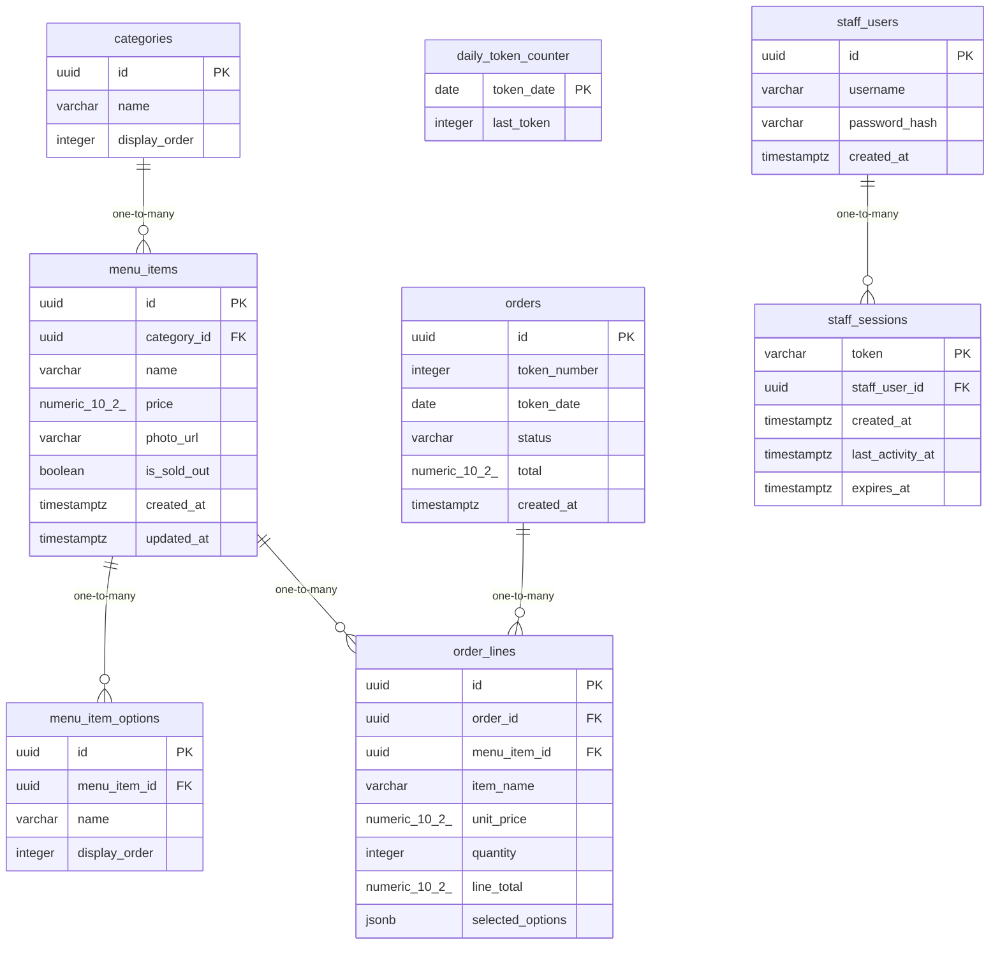

# Data Model

<!-- sdlc:auto:start entities -->
### categories

| Field | Type | PK | FK | Nullable |
|---|---|---|---|---|
| id | uuid | True | — | False |
| name | varchar | False | — | False |
| display_order | integer | False | — | False |

### menu_items

| Field | Type | PK | FK | Nullable |
|---|---|---|---|---|
| id | uuid | True | — | False |
| category_id | uuid | False | categories.id | False |
| name | varchar | False | — | False |
| price | numeric(10,2) | False | — | False |
| photo_url | varchar | False | — | True |
| is_sold_out | boolean | False | — | False |
| created_at | timestamptz | False | — | False |
| updated_at | timestamptz | False | — | False |

### menu_item_options

| Field | Type | PK | FK | Nullable |
|---|---|---|---|---|
| id | uuid | True | — | False |
| menu_item_id | uuid | False | menu_items.id | False |
| name | varchar | False | — | False |
| display_order | integer | False | — | False |

### orders

| Field | Type | PK | FK | Nullable |
|---|---|---|---|---|
| id | uuid | True | — | False |
| token_number | integer | False | — | False |
| token_date | date | False | — | False |
| status | varchar | False | — | False |
| total | numeric(10,2) | False | — | False |
| created_at | timestamptz | False | — | False |

### order_lines

| Field | Type | PK | FK | Nullable |
|---|---|---|---|---|
| id | uuid | True | — | False |
| order_id | uuid | False | orders.id | False |
| menu_item_id | uuid | False | menu_items.id | True |
| item_name | varchar | False | — | False |
| unit_price | numeric(10,2) | False | — | False |
| quantity | integer | False | — | False |
| line_total | numeric(10,2) | False | — | False |
| selected_options | jsonb | False | — | True |

### daily_token_counter

| Field | Type | PK | FK | Nullable |
|---|---|---|---|---|
| token_date | date | True | — | False |
| last_token | integer | False | — | False |

### staff_users

| Field | Type | PK | FK | Nullable |
|---|---|---|---|---|
| id | uuid | True | — | False |
| username | varchar | False | — | False |
| password_hash | varchar | False | — | False |
| created_at | timestamptz | False | — | False |

### staff_sessions

| Field | Type | PK | FK | Nullable |
|---|---|---|---|---|
| token | varchar | True | — | False |
| staff_user_id | uuid | False | staff_users.id | False |
| created_at | timestamptz | False | — | False |
| last_activity_at | timestamptz | False | — | False |
| expires_at | timestamptz | False | — | False |
<!-- sdlc:auto:end entities -->

<!-- sdlc:auto:start relationships -->
| Source | Target | Type |
|---|---|---|
| categories | menu_items | one-to-many |
| menu_items | menu_item_options | one-to-many |
| orders | order_lines | one-to-many |
| menu_items | order_lines | one-to-many |
| staff_users | staff_sessions | one-to-many |
<!-- sdlc:auto:end relationships -->

<!-- sdlc:auto:start er-diagram -->

<!-- sdlc:auto:end er-diagram -->
