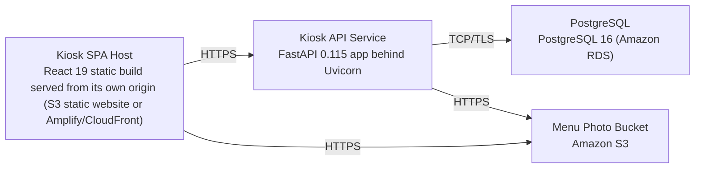

# Deployment Guide

> Maintained by QuorQ AI SDLC. Text between `sdlc:auto` markers is regenerated; anything outside them is yours and is kept.

<!-- sdlc:auto:start how-it-deploys -->
Pushes to `main` run `.github/workflows/deploy.yml`, which builds the API image (if there is a backend) and deploys the SPA to AWS Amplify. Commits touching only `docs/sdlc/**` don't deploy. Deployments can also be started from the platform's Deployment tab.
<!-- sdlc:auto:end how-it-deploys -->

<!-- sdlc:auto:start environments -->
| Name | Service | Runtime | Scaling | Environment |
|---|---|---|---|---|
| Kiosk SPA Host | React 19 static build served from its own origin (S3 static website or Amplify/CloudFront) | Static assets (Node 20 build) | Single-location static hosting, CDN-cached | dev |
| Kiosk API Service | FastAPI 0.115 app behind Uvicorn | Python 3.12 container on AWS (ECS/App Runner) | Single small instance for one bakery, restart-resilient | dev |
| PostgreSQL | PostgreSQL 16 (Amazon RDS) | Managed PostgreSQL 16 | Single instance with automated backups | dev |
| Menu Photo Bucket | Amazon S3 | S3 object storage | Managed, serves photos to kiosks directly | dev |
<!-- sdlc:auto:end environments -->

<!-- sdlc:auto:start live -->
_Not deployed yet._
<!-- sdlc:auto:end live -->

<!-- sdlc:auto:start topology -->

<!-- sdlc:auto:end topology -->
